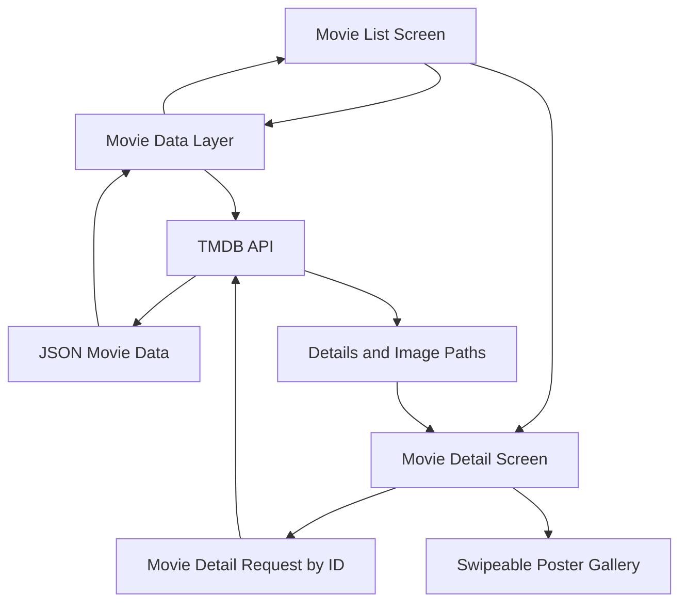

# 🎬 MovieList — iOS Movie Discovery App

An iOS app for browsing movies and exploring their details using data from [The Movie Database (TMDB)](https://www.themoviedb.org/). Built as part of **CIS 651: Mobile Application Programming** at Syracuse University.

MovieList focuses on a familiar mobile experience: browse a list of movies, tap one to see more information, and swipe through its artwork. The project also explores API integration, JSON decoding, reusable list cells, and separating application data from the interface.

## Features

- **Movie discovery:** Retrieve now-playing, popular, top-rated, and upcoming movie lists from TMDB.
- **Custom movie list:** Display poster thumbnails and titles in a `UITableView` with custom cells.
- **Movie details:** Select a movie to view its title, description, rating, and additional information fetched by movie ID.
- **Poster gallery:** Display remote poster and backdrop images in a swipeable `UICollectionView`.
- **Swipe to delete:** Remove entries from the currently displayed movie list.
- **Adaptive layouts:** Designed to work across different iPhone screen sizes.

## Demo

🎥 **[Watch the app demo](https://youtu.be/bE9cy0upkLE)**

## Tech Stack

| Area | Technology |
| --- | --- |
| Platform | iOS |
| Language | Swift |
| UI | UIKit, `UITableView`, `UICollectionView` |
| Movie data | TMDB REST API |
| Data handling | JSON, `Decodable` |
| Architecture | MVC or MVVM |
| Development | Xcode |

## How It Works

This is a **conceptual data-flow diagram**, not a verified representation of the project's classes. Adjust it to reflect the actual implementation.

### Movie list flow

1. Request a movie category from TMDB.
2. Decode the JSON response into Swift movie models.
3. Populate the table view with movie titles and poster images.
4. Handle row selection to open the corresponding movie detail screen.

### Movie detail flow

1. Use the selected movie's ID to request its details.
2. Display the movie information and a visual rating indicator.
3. Build remote image URLs from TMDB poster/backdrop paths.
4. Show the images in a horizontally swipeable collection view.

## Engineering Focus

**API integration and data modeling.** The app uses structured movie models conforming to Swift's `Decodable` protocol rather than manually extracting fields from JSON dictionaries.

**Master–detail navigation.** A list view provides quick discovery, while a separate detail screen presents richer information for the selected movie.

**Remote image loading.** Movie posters and backdrops are retrieved from TMDB instead of being bundled as static app assets. This makes the UI dependent on network responses and image URL handling.

**Reusable UI components.** Custom table view cells and collection view items help keep the list and image gallery consistent.

## Getting Started

### Requirements

- macOS with Xcode installed
- An iOS simulator or supported iPhone
- A [TMDB account and API credentials](https://www.themoviedb.org/settings/api)

### Run locally

1. Clone the repository
2. Open the project's `.xcodeproj` or `.xcworkspace` file in Xcode.
3. Configure your own TMDB credentials using the method supported by the codebase.
4. Select an iPhone simulator and run the application.

## Potential Improvements

- Search movies by title and filter by genre.
- Save favorites or a personal watchlist.
- Add loading, empty, and network-error states.
- Cache posters to reduce repeat downloads.
- Add unit tests for JSON decoding and API responses.
- Improve accessibility and support dark mode.

## Project Context

Created for **CIS 651: Mobile Application Programming** at Syracuse University to practice native iOS development, consuming a public API, and building a master–detail interface.

**GitHub:** [Kshahh](https://github.com/Kshahh)

### Data Attribution

Movie metadata and artwork are provided by [TMDB](https://www.themoviedb.org/). This project is not endorsed or certified by TMDB.
